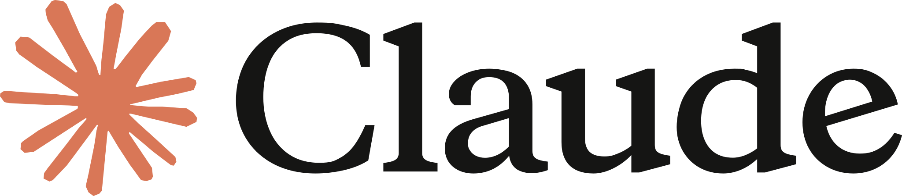

<br/>

<div align="center">
  <picture>
    <source media="(prefers-color-scheme: dark)" srcset="https://docs.once-ui.com/trademarks/icon-dark.svg" width="64" height="64">
    <source media="(prefers-color-scheme: light)" srcset="https://docs.once-ui.com/trademarks/icon-light.svg" width="64" height="64">
    
  </picture><picture>
    <source media="(prefers-color-scheme: dark)" srcset="https://docs.once-ui.com/trademarks/type-dark.svg" width="200" height="64">
    <source media="(prefers-color-scheme: light)" srcset="https://docs.once-ui.com/trademarks/type-light.svg" width="200" height="64">
    
  </picture>

  <br/>

  The open-source, agentic design system for React

  [](https://www.npmjs.com/package/@once-ui-system/core)
  [](./LICENSE.md)
  [](https://www.npmjs.com/package/@once-ui-system/core)
  [](https://discord.com/invite/5EyAQ4eNdS)
</div>


<br/>

## Documentation

Learn how to set up and build with Once UI at [docs.once-ui.com](https://docs.once-ui.com/quick-start).

## Installation

```bash
npm install @once-ui-system/core
```

## Upgrading

Coming from 1.8.x? See [MIGRATING.md](./MIGRATING.md) — a codemod does most of
it, and the rest is six short steps.

## Getting started

```bash
git clone https://github.com/once-ui-system/core.git
cd core
pnpm install
pnpm dev
```

This boots both apps in parallel via Turborepo:
- **Docs** → `http://localhost:3000`
- **Dev sandbox** → `http://localhost:3001`

> **Note:** `pnpm install` automatically builds the core library via a postinstall hook, so no separate build step is needed after initial setup.

## Project structure

This is a **pnpm monorepo** with Turborepo. See [ARCHITECTURE.md](./ARCHITECTURE.md) for the full directory layout, conventions, and where to contribute.

```
core/
├── packages/core/     # @once-ui-system/core — the design system library
├── apps/dev/          # Next.js 16 sandbox for component development
└── apps/docs/         # Next.js 16 documentation site
```

## Scripts

| Command | Description |
|---------|-------------|
| `pnpm dev` | Start all dev servers in parallel (docs → :3000, dev → :3001, core watch) |
| `pnpm build` | Build everything (library + apps) |
| `pnpm test` | Run all tests via Turbo |
| `pnpm lint` | Lint everything via Turbo |
| `pnpm typecheck` | Typecheck everything in parallel |
| `pnpm format` | Format all files |
| `pnpm clean` | Clean all build artifacts |
| `pnpm start` | Start all built apps (docs → :3000, dev → :3001) |

Individual workspace commands:

| Command | Description |
|---------|-------------|
| `pnpm dev:docs` | Docs app only → `http://localhost:3000` |
| `pnpm dev:dev` | Dev sandbox only → `http://localhost:3001` |
| `pnpm build:core` | Build just the library |
| `pnpm test:core` | Run core tests only |
| `pnpm lint:core` | Lint core only |
| `pnpm start:docs` | Start built docs app only |
| `pnpm start:dev` | Start built dev app only |

## AI codegen harness

The library ships an AI codegen harness in `packages/core/ai/` — a manifest, task bundles, component slices, and validation scripts. This powers the [Freebuff](https://freebuff.com) integration and enables AI agents to generate Once UI code correctly. See [AI Coding docs](https://docs.once-ui.com/ai-coding) for details.

## Authors

Built and maintained by [**Lorant One**](https://lorant.one).

## Community

Join the [Design Engineers Club](https://discord.com/invite/5EyAQ4eNdS) for help, support and discussion.

Found a bug? Report it [here](https://github.com/once-ui-system/core/issues/new?labels=bug&template=bug_report.md). Got a feature request? Submit it [here](https://github.com/once-ui-system/core/issues/new?labels=feature%20request&template=feature_request.md).

## Contributing

We welcome contributions! Before submitting a PR:

1. Read [ARCHITECTURE.md](./ARCHITECTURE.md) to understand the codebase layout.
2. Read [CONTRIBUTING.md](./CONTRIBUTING.md) for guidelines on code style, PR process, and conventions.
3. Test your changes in `apps/dev` — use `ComponentsCheckPage.tsx` to visually verify components.
4. Run `pnpm test` before submitting.

**Where to start:**
- Fix or add a component → `packages/core/src/components/`
- Fix a complex module (CodeBlock, etc.) → `packages/core/src/modules/`
- Update docs → `apps/docs/src/content/once-ui/`
- Change design tokens → `packages/core/src/tokens/`

## Sponsors

Once UI is an indie project, kept going by the companies and people who use it.

<h3 align="center">Supported by</h3>

<p align="center">
  <a href="https://neon.com"><picture>
    <source media="(prefers-color-scheme: dark)" srcset=".github/assets/sponsors/neon-logo-dark.svg">
    
  </picture></a>
  &nbsp;&nbsp;&nbsp;&nbsp;&nbsp;
  <a href="https://sentry.io"><picture>
    <source media="(prefers-color-scheme: dark)" srcset=".github/assets/sponsors/sentry-logo-dark.svg">
    
  </picture></a>
  &nbsp;&nbsp;&nbsp;&nbsp;&nbsp;
  <a href="https://claude.com"><picture>
    <source media="(prefers-color-scheme: dark)" srcset=".github/assets/sponsors/claude-logo-dark.svg">
    
  </picture></a>
</p>

<p align="center">
  <sub>Once UI is part of the <a href="https://neon.com">Neon</a> Open Source Program and <a href="https://sentry.io/for/open-source/">Sentry for Open Source</a>, and is built with <a href="https://claude.com">Claude</a>.</sub>
</p>

<h3 align="center">Become a sponsor</h3>

<table align="center">
  <tr>
    <th width="260">Founding</th>
    <th width="260">Ecosystem</th>
    <th width="260">Supporter</th>
  </tr>
  <tr align="center">
    <td><b>$2,000</b> / month<br/><sub>One partner at a time</sub></td>
    <td><b>$750</b> / month<br/><sub>Tools that sit next to Once UI</sub></td>
    <td><b>$250</b> / month<br/><sub>Teams shipping on Once UI</sub></td>
  </tr>
  <tr>
    <td valign="top"><sub>Logo in this README, on the docs site and on once-ui.com/sponsors · Named in every release · A standing line to the team</sub></td>
    <td valign="top"><sub>Logo in this README and on once-ui.com/sponsors · Named in every release for the term</sub></td>
    <td valign="top"><sub>Logo on once-ui.com/sponsors · Named in the quarter's release notes</sub></td>
  </tr>
</table>

<p align="center">
  <a href="https://once-ui.com/sponsors"><b>Sponsor Once UI →</b></a>
</p>

<p align="center">
  <sub>Individuals can sponsor through <a href="https://github.com/sponsors/once-ui-system">GitHub Sponsors</a> or <a href="https://thanks.dev/u/gh/once-ui-system">thanks.dev</a> and get featured on our site.</sub>
</p>
